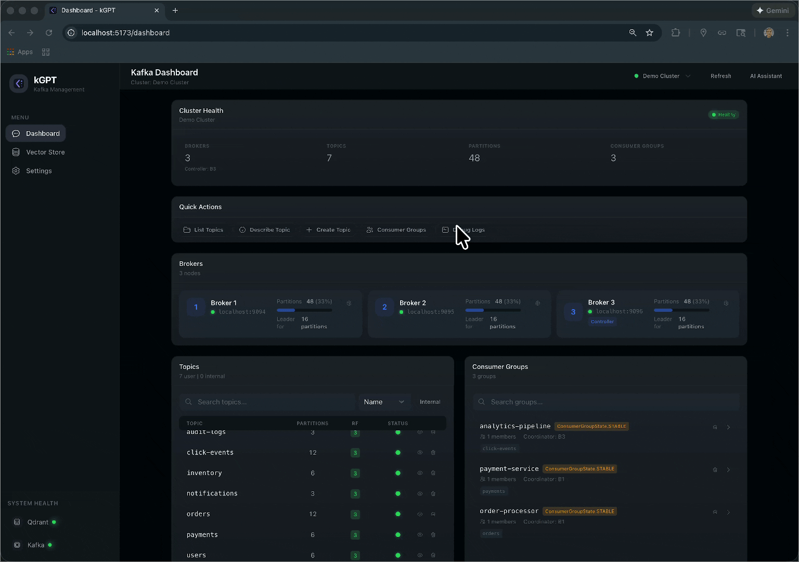
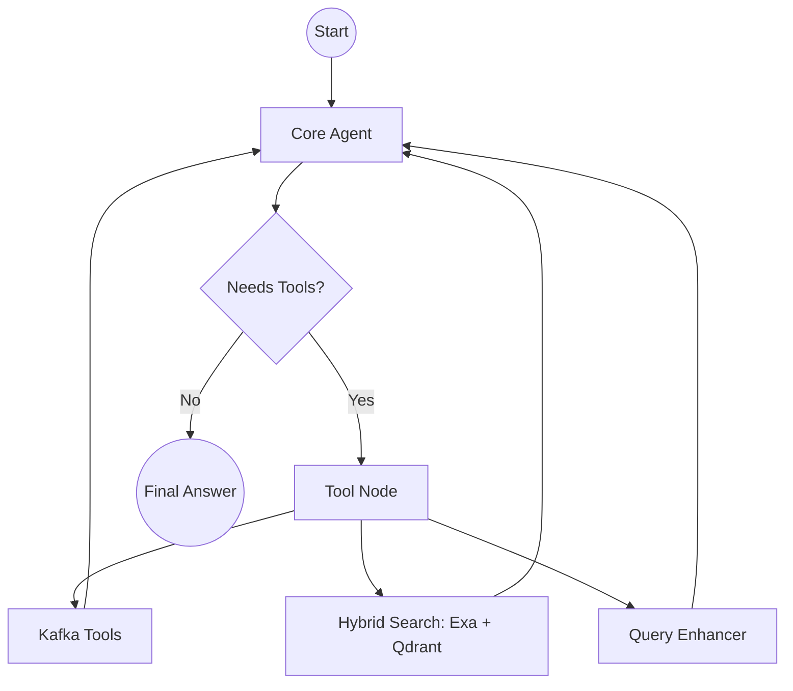

# kGPT

**AI-powered Kafka Assistant**

I built kGPT because I wanted to blend Kafka and AI. I wanted to be able to ask questions about my Kafka cluster and get answers. I also wanted to be able to ask questions about Kafka in general and get answers grounded in the official docs.

<!-- Quick Demo GIF -->


## 2022 RAG to 2025 Agentic

In 2022, I built the first version of kGPT as a simple RAG application. It used LangChain to vectorize Confluent docs into a FAISS store. It worked, but it was a static search. If the docs changed, the project broke until I re-indexed everything.

The 2025 version is a complete rethink. I swapped manual indexing for Exa (live web search) and built a UI to store custom documents in Qdrant. Now, the agent doesn't just look for stale data. It searches the entire internet in real time to find the latest blog posts, forum discussions, and official release notes.

## How it works

kGPT uses a **LangGraph-powered ReAct architecture**. Instead of a linear chain, the agent thinks in loops and chooses the right tools for the job.



1. **Strategic Routing**: The agent analyzes your query to decide if it needs docs, real-time web data, or live cluster metadata.
2. **Hybrid Search**: The `search` tool executes parallel queries across indexed docs and the live web, merging results with Reciprocal Rank Fusion (RRF).
3. **Cluster Introspection**: If the question is about your own brokers, the agent uses live Kafka tools to pull real-time topic, config, and consumer group data.
4. **Contextual Synthesis**: The agent synthesizes all evidence into a definitive answer with inline citations.

## Cool Features

- **Agent Trace View**: Watch the agent's thought process in real time. See exactly when it decides to search the web, check a Kafka topic, and how it builds the final answer.
- **Real Kafka Introspection**: Connect directly to your brokers. List topics, check consumer group lag, and see your cluster topology right in the app.
- **Hybrid Web/Doc Search**: Search internal docs and the live internet at the same time. This keeps answers grounded in official docs while staying aware of current events.
- **Sitemap Crawler**: Point kGPT at any document site or GitHub repo. It will ingest, chunk, and embed the whole thing into Qdrant in seconds with a real-time progress bar.
- **Cluster Topology Maps**: A visual view of your brokers and how they are connected. Makes debugging cluster health more intuitive.

## Quick Start

### Prerequisites

- Python 3.11+
- Node.js 20+
- Docker (for Qdrant)

### Run with Make

```bash
make install   # Install all dependencies
make dev       # Start the full environment
```

Visit the dashboard at [http://localhost:5173](http://localhost:5173).

## Project Structure

```text
kgpt/
├── frontend/                    # Svelte 5 + Tailwind
│   └── src/
│       ├── routes/              # Pages (chat, docs, cluster, settings)
│       └── lib/                 # UI Components
└── src/kgpt/
    ├── api/                     # FastAPI routes
    ├── agents/                  # LangGraph multi-agent logic
    ├── services/                # Kafka cluster service
    ├── ingestion/               # Sitemap and doc loaders
    └── vectorstore/             # Qdrant integration
```

## Make Commands

| Command | What it does |
|---------|-------------|
| `make install` | Install all dependencies |
| `make dev` | Start full dev environment |
| `make lint` | Run linters (ruff, eslint) |
| `make test` | Run test suite |
| `make build` | Build Docker images |

Run `make help` for the complete list.

---

**Built by [Michael Folino](https://www.linkedin.com/in/mfolino/)** • [Twitter](https://twitter.com/mvfolino68) • [GitHub](https://github.com/mvfolino68)
