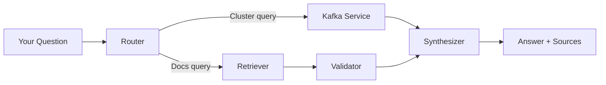
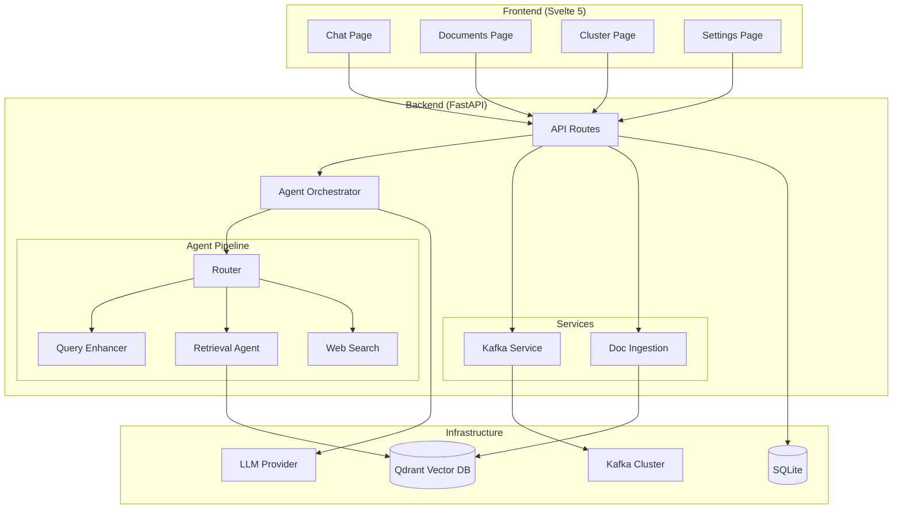
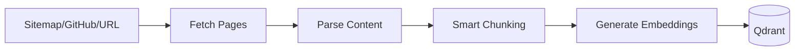

# kGPT

**Your AI-powered docs assistant for Kafka and Confluent—built to actually help.**

I built kGPT because documentation search sucks. You're debugging at 2am, you know the answer is *somewhere* in the docs, and you end up with 47 browser tabs open. kGPT fixes that. Ask a question in plain English, get a real answer with sources.

<!-- Quick Demo Video -->


## What it does

- **Actually answers questions** – not just links you to docs. Ask "how do I increase partition count?" and get a step-by-step answer with the exact commands.
- **Knows your cluster** – connect your real Kafka cluster and get context-aware answers about *your* topics, configs, and consumer groups.
- **Bring your own docs** – index Confluent docs, Apache Kafka docs, or your company's internal wikis.
- **Works with any LLM** – OpenAI, Anthropic, OpenRouter, or run fully local with Ollama.

## Quick demo

```bash
git clone https://github.com/mvfolino68/kGPT.git
cd kGPT
docker compose up
```

Open [http://localhost:3000](http://localhost:3000), add your API key in Settings, and start asking questions.

For development (hot-reload, faster iteration):

```bash
make install && make dev
```

## How it works

Under the hood, kGPT uses a multi-agent pipeline. When you ask a question, it goes through several steps:



**Router** figures out what you're asking—is this a docs question? Do we need cluster context? Should we run an admin operation?

**Retriever** searches the vector database for relevant documentation chunks using semantic search.

**Kafka Service** connects to your cluster (if configured) to pull real metadata about topics, configs, consumer groups, etc.

**Validator** checks retrieved docs for relevance and filters out noise.

**Synthesizer** pulls everything together into a coherent answer with proper citations.

## Architecture

Here's the full picture of how the pieces fit together:



## Features I'm proud of

### Document ingestion

Point kGPT at a sitemap and it'll crawl, chunk, and embed the whole thing. Watch progress in real-time.



### Real Kafka integration

This isn't just reading docs—kGPT can actually look at your cluster. The `KafkaService` class handles all the admin operations under the hood.

- List topics with partition counts and configs
- Describe consumer groups and their lag
- Create/delete topics (with confirmation prompts, obviously)
- Get broker configs

### Flexible LLM support

Use whatever model fits your budget and privacy needs:

| Provider | Local? | Notes |
|----------|--------|-------|
| Ollama | ✅ | Fully offline, great for sensitive data |
| OpenAI | ❌ | GPT-4o for best quality |
| Anthropic | ❌ | Claude is solid for technical docs |
| OpenRouter | ❌ | Access to all models, pay-per-token |

## Setup

### Prerequisites

- Python 3.11+
- Node.js 20+
- Docker (for Qdrant, or run standalone)
- An API key (unless using Ollama)

### Development mode (recommended)

```bash
make install   # Install Python + Node dependencies
make dev       # Start everything with hot-reload
```

Frontend: [http://localhost:5173](http://localhost:5173)
API docs: [http://localhost:8000/docs](http://localhost:8000/docs)

### Docker mode

```bash
docker compose up                           # Basic stack
docker compose --profile ollama up          # + local LLM
docker compose --profile demo up            # + demo Kafka cluster
```

Frontend: [http://localhost:3000](http://localhost:3000)

## Project structure

```text
kgpt/
├── frontend/                    # Svelte 5 + Tailwind
│   └── src/
│       ├── routes/              # Pages (chat, documents, cluster, settings)
│       └── lib/                 # Components and utilities
└── src/kgpt/
    ├── api/                     # FastAPI routes
    ├── agents/                  # LangGraph multi-agent system
    │   └── orchestrator/        # Graph builder and streaming
    ├── services/                # Kafka service
    ├── ingestion/               # Document loaders
    ├── vectorstore/             # Qdrant integration
    └── llm/                     # LLM provider abstraction
```

## Make commands

| Command | What it does |
|---------|-------------|
| `make install` | Install all dependencies |
| `make dev` | Start full dev environment |
| `make lint` | Run linters (ruff, eslint) |
| `make test` | Run test suite |
| `make build` | Build Docker images |

Run `make help` for the complete list.

## Environment variables

| Variable | Default | Description |
|----------|---------|-------------|
| `LLM_PROVIDER` | `openai` | `openai`, `anthropic`, `openrouter`, or `ollama` |
| `LLM_MODEL` | `gpt-4o` | Model to use |
| `OPENAI_API_KEY` | — | Your OpenAI key |
| `QDRANT_URL` | `http://localhost:6333` | Vector database URL |

See `.env.example` for all options.

## Why I built this

I've spent way too many hours digging through Kafka documentation. The official docs are thorough but hard to navigate when you're troubleshooting. I wanted something that could:

1. Actually understand my question
2. Search the docs intelligently
3. Give me a synthesized answer, not just links
4. Know about *my* cluster when relevant

This project is my attempt at solving that. It's also a chance to play with LangGraph, FastAPI, and Svelte 5—tech I genuinely enjoy working with.

## Contributing

PRs welcome! Check out [DEVELOPMENT.md](DEVELOPMENT.md) for setup details and contribution guidelines.

## License

MIT—do whatever you want with it.

---

**Built by [Michael Folino](https://www.linkedin.com/in/mfolino/)** • [Twitter](https://twitter.com/mvfolino68) • [GitHub](https://github.com/mvfolino68)
